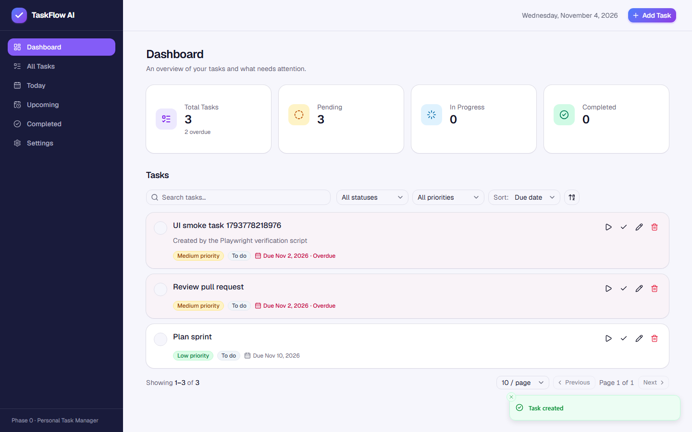
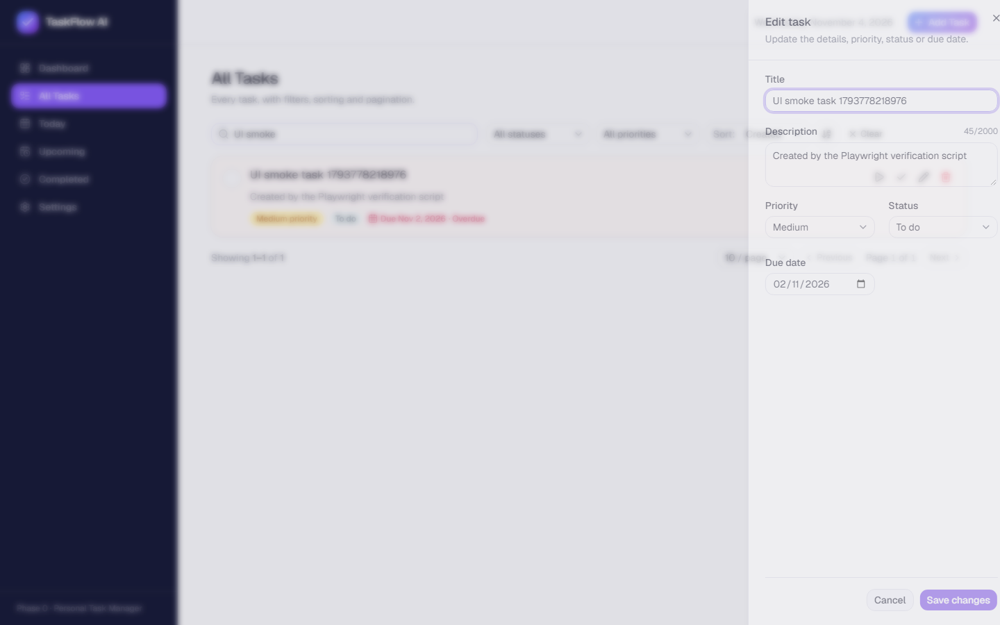
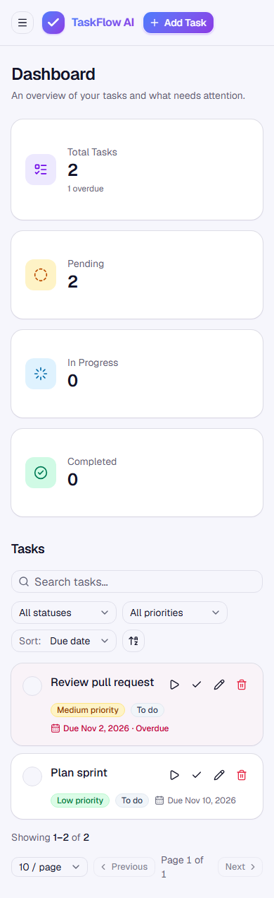

# TaskFlow AI — Phase 3.4

A modern, full-stack **personal task manager** built with **Spring Boot 3**, **PostgreSQL** and **Next.js**, with an
**AI assistant** powered by **LangChain4j** and **OpenAI**: a single `TaskAgent` (Phase 1), a **multi-agent system** in
which a `TaskFlowSupervisor` routes each request to `TaskAgent`, `PriorityAgent`, `PlanningAgent` or `SummaryAgent`
(Phase 2), **Keycloak sign-in with per-user data** (Phase 3.0) and, new in Phase 3.1, an **evaluation framework**
that measures the agent system on a version-controlled scenario dataset, with a scripted regression tier in every
build and an opt-in live-model baseline.

This repository accompanies the Medium article series
**"Building Agentic AI Applications with Java: From Spring Boot to Multi-Agent Systems Using LangChain4j"**.

| Phase | Scope | Status |
|---|---|---|
| Phase 0 | Traditional full-stack task manager | ✅ Implemented |
| Phase 1 | LangChain4j + OpenAI (`gpt-4o-mini`) + a single `TaskAgent` | ✅ Implemented |
| Phase 2 | `TaskFlowSupervisor` orchestrating `TaskAgent`, `PriorityAgent`, `PlanningAgent`, `SummaryAgent` | ✅ Implemented |
| Phase 3.0 | Identity foundation: Keycloak + Spring Security, per-user data, AI tools scoped to the authenticated user | ✅ Implemented |
| Phase 3.1 | Evaluation framework: scenario dataset, scripted regression tier, opt-in live-model baseline, reproducible reports | ✅ Implemented |
| Phase 3.2 | Deterministic rules: task rules for every write, estimated minutes, structured rule-checked day plans | ✅ Implemented |
| **Phase 3.3** | Guardrails: input scope and injection checks, untrusted tool data, a write limit per message, grounded output checks on each agent (LangChain4j `OutputGuardrail` with one reprompt) and on the final answer, with a safe fallback | ✅ Implemented |
| **Phase 3.4** | Isolated persistent memory: chat memory in PostgreSQL per user, conversation and agent, staged commits (a rejected answer is never remembered), transcript, conversation list with resume and delete, 30-day retention (this repository state) | ✅ Implemented |
| Phase 3.5 | Runtime AI governance | Planned |

> Phase 1 added exactly one agent: the `TaskAgent` creates, finds, reads and (since Phase 2) updates tasks through
> LangChain4j tools that call the Phase 0 `TaskService`, and remembers the conversation. Phase 2 adds three read-only
> specialists and a supervisor built with `langchain4j-agentic`. The Phase 1 endpoint keeps working unchanged next to
> the new one, so both can be compared on the same data. There is still no delete tool.

---

## 1. Project overview

TaskFlow AI lets each signed-in user organise daily tasks, manage priorities, track deadlines and monitor progress through:

- a responsive **Next.js dashboard** (sidebar navigation, statistics cards, filterable/sortable/paginated task list, create/edit drawer, settings page),
- a documented **REST API** (Swagger UI) backed by PostgreSQL, and
- an **AI assistant** page where you manage tasks in plain language ("create a high-priority task for Friday"), and
  since Phase 2 ask for prioritisation, a plan for the day or a progress summary ("plan my day") and let the supervisor
  pick the right agent.

Since Phase 3.0 users sign in with Keycloak (demo users `alice` / `alice` and `bob` / `bob`), and each user only ever
sees and changes their own tasks, preferences and assistant conversations
(see [`docs/phase-3.0/IMPLEMENTATION.md`](docs/phase-3.0/IMPLEMENTATION.md)).

### Screenshots

Captured from the running application (see [`docs/phase-0/screenshots`](docs/phase-0/screenshots)).

| Dashboard | Edit drawer | Mobile |
|---|---|---|
|  |  |  |

Phase 1 (see [`docs/phase-1/screenshots`](docs/phase-1/screenshots)):

| AI assistant | Mobile |
|---|---|
|  |  |

Phase 2 (see [`docs/phase-2/screenshots`](docs/phase-2/screenshots)):

| Supervisor: plan my day | Supervisor: execution details | Mobile |
|---|---|---|
|  |  |  |

### Features

- Full task CRUD with status (`TODO`, `IN_PROGRESS`, `COMPLETED`) and priority (`LOW`, `MEDIUM`, `HIGH`)
- Complete / reopen tasks with automatic `completedAt` handling
- Database-level filtering (status, priority, due date, date range, free-text search), sorting and pagination
- Dashboard statistics: total, pending, in progress, completed, overdue, due today (timezone-aware)
- User preferences: IANA timezone and daily available minutes
- Validation on both sides (Jakarta Bean Validation + Zod), consistent `ProblemDetail` error responses
- Loading skeletons, empty states, toasts, delete confirmation, URL-synchronised filters

**Phase 1 — AI assistant**

- `TaskAgent`, a LangChain4j AI Service (`@AiService`) backed by OpenAI, with tool calling over the existing `TaskService`
- Tools: `createTask`, `getTaskById`, `listTasks` (filters, sorting, pagination), `updateTask`, `updateTaskStatus`,
  `getToday` — the model never touches a repository
- Conversation memory: a sliding window of messages per `conversationId` (in process)
- Tool errors are translated into instructions the model can act on (invalid date, unknown task, validation failure);
  provider failures (rate limit, timeout, bad key) become clear `ProblemDetail` responses for the UI
- Chat UI with message bubbles, loading/error states with retry, a "new conversation" action and automatic refresh of task views

**Phase 2 — multi-agent system**

- `TaskFlowSupervisor`: a LangChain4j supervisor agent (`langchain4j-agentic`). An LLM planner reads the agent cards
  (name, description, arguments), calls one sub-agent at a time and stops when the request is answered
- `PriorityAgent` ranks open tasks by urgency, priority and status with a reason per task; `PlanningAgent` builds a
  time-boxed plan inside the user's daily available minutes; `SummaryAgent` reports progress, overdue and recent work
- The three specialists are **read-only by construction**: they only receive `TaskQueryTools` (`findTasks`,
  `getTaskStatistics`, `getPlanningContext`); only `TaskAgent` holds the tools that change data
- Today's date, weekday, timezone and daily available minutes are injected into every agent's system message at call
  time, so "tomorrow" and "overdue" are resolved correctly
- `POST /api/ai/supervisor/chat` returns the answer plus the agents invoked, the tools called, the number of LLM calls
  and the token usage, so routing cost is visible (the input for the Phase 3 evaluations)
- The UI has a **Supervisor / TaskAgent** switch; "Execution details" under each reply shows the route taken

**Phase 3.0 — identity foundation**

- Keycloak 26 (in `infrastructure/docker-compose.yml`) with the `taskflow` realm, demo users `alice` and `bob`
- The backend is an OAuth2 resource server: every `/api/**` request needs a Keycloak access token (issuer, signature,
  expiry and the `taskflow-api` audience are validated); Swagger stays public
- `CurrentUserProvider` is the only source of the caller's identity; users are created on their first request
- Tasks, preferences and AI conversations have an owner (Flyway `V3__add_user_identity.sql`); every query is scoped to
  it, and another user's task or conversation returns `404`
- The AI tools take no user id: a task id from another user, even injected into a prompt, is "not found"
- Conversation ids are issued by the server (`POST /api/ai/conversations`) and checked before any agent runs
- The Next.js app signs in with Authorization Code + PKCE and sends the access token with every request

---

## 2. Technology stack

**Backend**

- Java 21, Spring Boot 3.5, Spring Web, Spring Data JPA, Spring Validation
- PostgreSQL 16, Flyway migrations
- Springdoc OpenAPI 2 (Swagger UI), Lombok, Maven
- JUnit 5, Mockito, Testcontainers
- **LangChain4j 1.23.0** (`langchain4j-spring-boot-starter`, `langchain4j-open-ai-spring-boot-starter`) and the **OpenAI API** (`gpt-4o-mini` by default)

**Frontend**

- Next.js 16 (App Router), React 19, TypeScript
- Tailwind CSS 4, shadcn/ui (Radix), Lucide icons
- React Hook Form + Zod
- Vitest + Testing Library

**Infrastructure**

- Docker Compose for PostgreSQL (only the database runs in Docker)

---

## 3. Architecture

```text
┌────────────────────────┐        HTTP / JSON        ┌───────────────────────────────┐
│  Next.js (App Router)  │ ────────────────────────▶ │  Spring Boot (REST API)        │
│  components / hooks    │ ◀──────────────────────── │                                │
│  lib/api (fetch client)│                           │  controller  → HTTP only       │
└────────────────────────┘                           │      │                         │
                                                     │  service     → business rules  │
                                                     │      │                         │
                                                     │  repository  → Spring Data JPA │
                                                     │      │         + Specifications│
                                                     └──────┼─────────────────────────┘
                                                            ▼
                                                     ┌───────────────┐
                                                     │  PostgreSQL   │  (Flyway-managed schema)
                                                     │  tasks        │
                                                     │  user_prefs   │
                                                     └───────────────┘
```

Phase 1 added the agent path next to the REST path; Phase 2 puts a supervisor in front of several agents. All paths
end in the same services:

```text
Next.js  /assistant  ──▶  POST /api/ai/chat  ──▶  AiChatController   (validates, translates provider errors)
                                                     │
                                                     ▼
                                               TaskAgent  @AiService   (LangChain4j: system prompt + chat memory)
                                                     │  ◀──────────▶  OpenAI API (chat completions, tool calls)
                                                     ▼
                                               TaskTools  @Tool        (createTask, getTaskById, listTasks)
                                                     │
                                                     ▼
                                               TaskService  ──▶  TaskRepository  ──▶  PostgreSQL
```

The loop: LangChain4j sends the prompt, the conversation memory and the tool schemas to the model. The model answers
either with a tool call or with text. A tool call runs a Java method on `TaskTools`, which validates the arguments and
calls the same `TaskService` the REST API uses; the result goes back to the model, which decides again. Text ends the
loop and becomes the reply. This is **tool calling, not MCP**: the tools live in the same JVM as the agent.

Phase 2 adds a second entry point with a planner on top:

```text
Next.js  /assistant (Supervisor mode)  ──▶  POST /api/ai/supervisor/chat  ──▶  AiChatController
                                                                                   │
                                                                                   ▼
                                                                             MultiAgentService   (lock per conversation, request id, error translation)
                                                                                   │
                                                                                   ▼
                                        TaskFlowSupervisor  (LangChain4j supervisor: planner LLM + chat memory)
                                                 │  "which agent next?"  ◀──────▶  OpenAI
                                                 │
                 ┌───────────────────────────────┼─────────────────────────────┬──────────────────────────────┐
                 ▼                               ▼                             ▼                              ▼
           TaskAgent                      PriorityAgent                  PlanningAgent                  SummaryAgent
      (memory per conversation)            (read-only)                    (read-only)                    (read-only)
           TaskTools                     TaskQueryTools                 TaskQueryTools                 TaskQueryTools
     create/list/get/update/status    findTasks/statistics/context   findTasks/statistics/context   findTasks/statistics/context
                 └───────────────────────────────┴─────────────────────────────┴──────────────────────────────┘
                                                 ▼
                                   TaskService / DashboardService / PreferencesService  ──▶  PostgreSQL
```

The supervisor's planner is itself an LLM call that only sees the agents' names, descriptions and arguments (never the
tools). Each step it returns `{"agentName": "...", "arguments": {"request": "..."}}` or `{"agentName": "done", ...}`.
A request like "summarise my week and plan tomorrow" therefore costs: planner → SummaryAgent (with its tool rounds) →
planner → PlanningAgent (with its tool rounds) → planner "done". The response reports exactly that: which agents ran,
which tools they called, how many LLM calls were made and how many tokens were used.

Repository layout:

```text
taskflow-ai/
├── backend/          Spring Boot application (Maven); backend/.env.example lists every variable
├── frontend/         Next.js application
├── infrastructure/   docker-compose.yml for PostgreSQL
├── docs/phase-0/     Implementation notes for the Phase 0 article
├── docs/phase-1/     Implementation notes for the Phase 1 article
├── docs/phase-2/     Implementation notes for the Phase 2 article
└── README.md
```

Backend packages (`backend/src/main/java/com/taskflow`):

```text
controller/     TaskController, DashboardController, PreferencesController, AiChatController (/api/ai/**)
service/        TaskService, DashboardService, PreferencesService
repository/     TaskRepository, PreferencesRepository
specification/  TaskFilter, TaskSort, TaskSpecifications  (DB-level filtering & sorting)
entity/         Task, UserPreferences
enums/          TaskStatus, TaskPriority
dto/            request/ and response/ records (API contracts)
mapper/         entity -> DTO mapping
exception/      GlobalExceptionHandler (ProblemDetail), TaskNotFoundException
validation/     @ValidTimezone
config/         ClockConfig, CorsConfig, OpenApiConfig
ai/             everything AI lives here
  agent/          TaskAgent            Phase 1 AI Service (@AiService) and Phase 2 sub-agent (@Agent)
                  PriorityAgent, PlanningAgent, SummaryAgent   read-only specialists (@Agent)
                  TaskFlowSupervisor   the supervisor interface (@Agent, @MemoryId)
  service/        MultiAgentService    one supervisor request: lock per conversation, MDC ids, error translation
  orchestration/  TaskFlowAgentFactory builds the agents and the supervisor with AgenticServices (plain Java)
                  MultiAgentService    one request: lock per conversation, MDC ids, error translation
                  AgentRunRecorder     AgentListener: agents/tools/LLM calls/tokens per request
                  AgentContextProvider today's date, timezone, daily minutes appended to every system message
                  TokenAccountingChatModel  counts every LLM call made by any agent
  config/         AiConfig             ChatMemoryProvider (sliding window per conversation)
                  MultiAgentConfig, SupervisorProperties   Phase 2 beans and taskflow.ai.supervisor.* limits
  tool/           TaskTools            read/write @Tool methods for TaskAgent (create, list, get, update, status, date)
                  TaskQueryTools       read-only @Tool methods for the specialists (findTasks, statistics, context)
  dto/            SupervisorChatResponse, AgentCallInfo, ToolCallInfo, AgentDescriptor
  exception/      ToolExecutionException (messages written for the model),
                  AiServiceException     (provider failures translated for the user)
resources/prompts/  task-agent-system.txt, priority-agent-system.txt, planning-agent-system.txt,
                    summary-agent-system.txt, supervisor-context.txt
```

Frontend layout (`frontend/`):

```text
app/            Routes: / (dashboard), /assistant (AI chat), /tasks, /today, /upcoming, /completed, /settings
components/     layout/, dashboard/, tasks/, assistant/ (chat, bubbles, composer, example prompts, mode switch), settings/, providers/, ui/
hooks/          useTasks, useDashboardStats, useTaskMutations, useTaskQueryParams, useApiQuery, useAssistant
lib/api/        Centralised fetch client + per-resource API modules (tasks, dashboard, preferences, ai)
lib/validations Zod schemas (task, preferences)
types/          TypeScript types mirroring the backend DTOs
__tests__/      Vitest + Testing Library tests
```

---

## 4. Prerequisites

| Tool | Version | Notes |
|---|---|---|
| Java (JDK) | 21 | `java -version` |
| Maven | 3.9+ | `mvn -version` |
| Node.js | 20.19+ or 22+ (tested with 24) | `node -v` |
| npm | 10+ | `npm -v` |
| Docker Desktop (or Docker Engine + Compose v2) | any recent | Only required for PostgreSQL and the backend integration tests |

---

## 5. PostgreSQL and Keycloak setup

Start PostgreSQL and Keycloak with Docker Compose:

```bash
cd infrastructure
docker compose up -d               # both services
docker compose up -d keycloak      # only Keycloak, if you use a locally installed PostgreSQL
```

Keycloak runs on <http://localhost:8180> (admin console: `admin` / `admin`) in development mode and imports the
`taskflow` realm from `infrastructure/keycloak/taskflow-realm.json` on start, with the demo users `alice` / `alice` and
`bob` / `bob`. Its data is in memory, so removing the container resets it to the realm file.

Docker Compose also starts `postgres:16-alpine` on `localhost:5432` with database/user/password `taskflow` / `taskflow` / `taskflow`
(override via `infrastructure/.env`, see `.env.example`). Data is persisted in the `taskflow_pgdata` volume.

Useful commands:

```bash
docker compose ps                 # status
docker compose logs -f postgres   # logs
docker compose down               # stop (keeps data)
docker compose down -v            # stop and delete data
```

> **Port 5432 already in use?** If a PostgreSQL service is installed on your machine it usually owns `5432`, and the
> backend would connect to it instead of the container. Map the container to another port and point the backend at it:
>
> ```bash
> # infrastructure/.env
> POSTGRES_PORT=5433
> ```
>
> ```bash
> # when starting the backend
> DB_URL=jdbc:postgresql://localhost:5433/taskflow mvn spring-boot:run
> ```

If you prefer a locally installed PostgreSQL, create the database and user manually and point the backend at it with the
environment variables in section 8. Flyway creates the tables on first start.

---

## 6. OpenAI configuration

The assistant needs an OpenAI API key. The chat model is created by `langchain4j-open-ai-spring-boot-starter` from the
`langchain4j.open-ai.chat-model.*` properties in `application.yml`, so there is no model code to write:

1. Create an API key at [platform.openai.com](https://platform.openai.com/api-keys).
2. Export it (or copy `backend/.env.example` to `backend/.env`):

```bash
export OPENAI_API_KEY="sk-..."
# optional, defaults shown
export OPENAI_MODEL_NAME="gpt-4o-mini"
export OPENAI_TEMPERATURE="0.2"
```

3. Start the backend. `GET /api/ai/status` returns `{"available": true, "model": "gpt-4o-mini"}` and the
   **AI Assistant** page in the UI shows a green dot.

Any model that supports tool calling works; `gpt-4o-mini` is the default because it is cheap and fast enough for the
demo. Set `OPENAI_LOG_REQUESTS=true` / `OPENAI_LOG_RESPONSES=true` to see the full prompts and tool calls in the log
(development only: they include task text). Keys are never logged and never reach the browser; all LLM traffic stays
in the backend. Never commit a real key: `application.yml` must only reference `${OPENAI_API_KEY}`.

---

## 7. Backend startup

```bash
cd backend
mvn spring-boot:run
```

The API starts on <http://localhost:8080>. On startup Flyway applies `V1__create_tasks.sql`,
`V2__create_user_preferences.sql` and `V3__add_user_identity.sql`, then Hibernate validates that the entities match the
schema (`ddl-auto=validate`). V3 hands tasks and preferences created before Phase 3.0 to the demo user `alice`.

> **Flyway reports a checksum mismatch for version 3?** Your database already has a different V3 from an earlier
> experiment. Use a fresh database for this phase, for example `CREATE DATABASE taskflow_identity;` and
> `DB_URL=jdbc:postgresql://localhost:5432/taskflow_identity`.

Every `/api/**` request needs a Keycloak access token; without one the API answers `401`. Keycloak does not have to be
running for the backend to start: the token issuer is contacted on the first authenticated request.

To build a runnable jar:

```bash
mvn clean package -DskipTests
java -jar target/taskflow-backend-0.1.0-SNAPSHOT.jar
```

---

## 8. Frontend startup

```bash
cd frontend
npm install
npm run dev
```

Copy `.env.example` to `.env.local` first (it contains the Keycloak settings). Open <http://localhost:3000>: you are sent
to the Keycloak sign-in page; sign in as `alice` / `alice` or `bob` / `bob`. The frontend talks to the backend at
`http://localhost:8080` by default (configurable, see below).

Production build:

```bash
npm run build
npm start
```

---

## 9. Environment variables

**Backend** (`backend/src/main/resources/application.yml` reads these; all but the API key have defaults):

| Variable | Default | Description |
|---|---|---|
| `DB_URL` | `jdbc:postgresql://localhost:5432/taskflow` | JDBC URL |
| `DB_USERNAME` | `taskflow` | Database user |
| `DB_PASSWORD` | `taskflow` | Database password |
| `SERVER_PORT` | `8080` | HTTP port |
| `CORS_ALLOWED_ORIGINS` | `http://localhost:3000` | Comma-separated list of allowed origins |
| `KEYCLOAK_ISSUER_URI` | `http://localhost:8180/realms/taskflow` | Phase 3.0: issuer of the access tokens the API accepts |
| `KEYCLOAK_API_AUDIENCE` | `taskflow-api` | Phase 3.0: audience (`aud`) every access token must contain |
| `OPENAI_API_KEY` | *(unset)* | OpenAI API key; required for the assistant |
| `OPENAI_MODEL_NAME` | `gpt-4o-mini` | Any OpenAI chat model that supports tool calling |
| `OPENAI_TEMPERATURE` | `0.2` | Sampling temperature |
| `OPENAI_LOG_REQUESTS` / `OPENAI_LOG_RESPONSES` | `false` | Log full LLM request/response bodies (development only) |
| `AI_MEMORY_MAX_MESSAGES` | `30` | Messages kept per conversation (sliding window), TaskAgent |
| `AI_MEMORY_RETENTION` | `30d` | Phase 3.4: conversations without activity for this long are deleted with their memory and transcript |
| `AI_MEMORY_MAX_CONVERSATIONS` | `100` | Phase 3.4: conversations kept per user; the least recently used are deleted beyond this |
| `AI_MEMORY_MAX_STORED_BYTES` | `262144` | Phase 3.4: upper bound on one stored memory window (JSON characters) |
| `AI_MEMORY_CLEANUP_INTERVAL` | `PT1H` | Phase 3.4: how often the retention job runs |
| `AI_GUARDRAILS_ENABLED` | `true` | Phase 3.3: input, tool and output guardrails |
| `AI_GUARDRAILS_MAX_WRITES` | `10` | Phase 3.3: task changes one assistant message may make |
| `AI_GUARDRAILS_OUTPUT_RETRIES` | `1` | Phase 3.3: reprompts of an agent whose answer failed the output check, before the safe fallback |
| `AI_SUPERVISOR_MAX_AGENT_INVOCATIONS` | `5` | Phase 2: sub-agent calls allowed per message (each costs ≥ 2 LLM calls) |
| `AI_SUPERVISOR_MAX_TOOL_ROUND_TRIPS` | `8` | Phase 2: tool calls allowed inside one sub-agent invocation |
| `AI_SUPERVISOR_MEMORY_MAX_MESSAGES` | `20` | Phase 2: the supervisor's own planning memory per conversation |
| `AI_SUPERVISOR_RESPONSE_STRATEGY` | `LAST` | Phase 2: `LAST` (the agents' answers verbatim, in order; one agent: its answer), `SUMMARY` (planner recap) or `SCORED` |
| `AI_SUPERVISOR_CONTEXT_STRATEGY` | `CHAT_MEMORY` | Phase 2: how the planner remembers earlier turns (`CHAT_MEMORY`, `SUMMARIZATION`, `CHAT_MEMORY_AND_SUMMARIZATION`) |

Other `taskflow.ai.*` keys in `application.yml` (`max-tool-round-trips`, `memory.retention`,
`memory.max-conversations`, `confirmation.ttl`) are reserved for later work and are not read by the current code.

**Frontend** (copy `frontend/.env.example` to `frontend/.env.local` to override):

| Variable | Default | Description |
|---|---|---|
| `NEXT_PUBLIC_API_BASE_URL` | `http://localhost:8080` | Base URL of the Spring Boot API |
| `NEXT_PUBLIC_KEYCLOAK_URL` | `http://localhost:8180` | Keycloak base URL |
| `NEXT_PUBLIC_KEYCLOAK_REALM` | `taskflow` | Keycloak realm |
| `NEXT_PUBLIC_KEYCLOAK_CLIENT_ID` | `taskflow-web` | Public client used for the PKCE sign-in |

**Infrastructure** (copy `infrastructure/.env.example` to `infrastructure/.env` to override):

| Variable | Default |
|---|---|
| `POSTGRES_DB` | `taskflow` |
| `POSTGRES_USER` | `taskflow` |
| `POSTGRES_PASSWORD` | `taskflow` |
| `POSTGRES_PORT` | `5432` |
| `KEYCLOAK_PORT` | `8180` |
| `KEYCLOAK_ADMIN` / `KEYCLOAK_ADMIN_PASSWORD` | `admin` / `admin` |

---

## 10. Swagger / OpenAPI

With the backend running:

- Swagger UI: <http://localhost:8080/swagger-ui/index.html>
- OpenAPI JSON: <http://localhost:8080/v3/api-docs>

Endpoints are grouped under the **Tasks**, **Dashboard**, **Preferences** and **AI Assistant** tags, with request/response
schemas, validation constraints and the documented error responses.

To call the API from Swagger UI, get a token for a demo user with the development-only `taskflow-dev-cli` client and
paste it under **Authorize**:

```bash
curl -s -d client_id=taskflow-dev-cli -d grant_type=password -d username=alice -d password=alice \
  http://localhost:8180/realms/taskflow/protocol/openid-connect/token | jq -r .access_token
```

The curl examples below assume that token is in `$TOKEN`.

---

## 11. API endpoint summary

| Method | Path | Description | Success |
|---|---|---|---|
| `POST` | `/api/tasks` | Create a task (status `TODO`, priority defaults to `MEDIUM`) | `201` |
| `GET` | `/api/tasks` | List tasks with filtering, sorting and pagination | `200` |
| `GET` | `/api/tasks/{id}` | Get one task | `200` |
| `PUT` | `/api/tasks/{id}` | Replace title, description, priority, status, due date | `200` |
| `PATCH` | `/api/tasks/{id}/status` | Change status (complete / reopen) | `200` |
| `DELETE` | `/api/tasks/{id}` | Delete a task | `204` |
| `GET` | `/api/dashboard/stats` | Counts: total, pending, inProgress, completed, overdue, dueToday | `200` |
| `GET` | `/api/preferences` | Read preferences | `200` |
| `PUT` | `/api/preferences` | Update timezone and daily available minutes | `200` |
| `GET` | `/api/ai/status` | Whether the assistant is configured (`available`, `model`) | `200` |
| `POST` | `/api/ai/conversations?mode=supervisor\|agent` | Start a conversation; returns a server-issued `conversationId` owned by the caller (Phase 3.0; `mode` since 3.4) | `201` |
| `GET` | `/api/ai/conversations` | The caller's conversations, most recent first (Phase 3.4) | `200` |
| `GET` | `/api/ai/conversations/{id}/messages` | The stored transcript of one of the caller's conversations (Phase 3.4) | `200` / `404` |
| `DELETE` | `/api/ai/conversations/{id}` | Delete a conversation with its memory and transcript (Phase 3.4) | `204` / `404` |
| `POST` | `/api/ai/chat` | Send a message to the single `TaskAgent` (Phase 1) | `200` |
| `POST` | `/api/ai/supervisor/chat` | Send a message to the `TaskFlowSupervisor`, which routes to the specialised agents (Phase 2) | `200` |
| `GET` | `/api/ai/agents` | The agents behind the supervisor (name, description, whether they can modify tasks) | `200` |

List query parameters for `GET /api/tasks`:

| Parameter | Example | Notes |
|---|---|---|
| `status` | `TODO` or `TODO,IN_PROGRESS` | One or more statuses |
| `priority` | `HIGH` | |
| `dueDate` | `2026-11-02` | Exact date |
| `dueDateFrom` / `dueDateTo` | `2026-11-03` | Inclusive range |
| `search` | `article` | Case-insensitive match on title or description |
| `sortBy` | `DUE_DATE`, `PRIORITY`, `CREATED_AT` (default), `UPDATED_AT` | Priority sorts by rank, not alphabetically |
| `sortDirection` | `ASC`, `DESC` (default) | |
| `page` / `size` | `0` / `10` | Zero-based page; size 1–100 |

Example:

```http
GET /api/tasks?status=TODO&priority=HIGH&sortBy=DUE_DATE&sortDirection=ASC&page=0&size=10
```

Errors use RFC 9457 Problem Details (`application/problem+json`):

```json
{
  "type": "about:blank",
  "title": "Validation error",
  "status": 400,
  "detail": "Validation failed",
  "instance": "/api/tasks",
  "errors": { "title": "Title must not be blank" }
}
```

| Situation | Status |
|---|---|
| Validation error / invalid enum value / malformed body | `400` |
| Missing, expired or invalid access token | `401` |
| Unknown task id, or a task or conversation owned by another user | `404` |
| OpenAI rate limited (`retryable: true`) | `429` |
| OpenAI rejected the request (e.g. invalid request) | `502` |
| OpenAI unavailable, bad API key or unknown model | `503` |
| OpenAI timed out | `504` |
| Unexpected error | `500` |

---

## 12. AI chat API

### Send a message

Start a conversation first: `POST /api/ai/conversations` returns a `conversationId` owned by the signed-in user. Send it
with every message of that conversation; the backend keeps a separate chat memory per conversation and rejects (`404`)
an id it did not issue to this user. Both fields are required.

```http
POST /api/ai/chat
Content-Type: application/json

{ "conversationId": "6f1c2d3e-4b5a-4c6d-8e7f-9a0b1c2d3e4f",
  "message": "Create a high-priority task to review the architecture document on 2026-11-14." }
```

```json
{
  "conversationId": "6f1c2d3e-4b5a-4c6d-8e7f-9a0b1c2d3e4f",
  "message": "Created \"Review the architecture document\" with HIGH priority, due 2026-11-14."
}
```

Send the same `conversationId` on the next message to keep context ("Change **its** priority to LOW"); the UI's
**New conversation** button starts a fresh id. A message is limited to 4 000 characters. After every reply the UI
refreshes the task lists and statistics.

With curl:

```bash
CONV=$(curl -s -X POST http://localhost:8080/api/ai/conversations -H "Authorization: Bearer $TOKEN" | jq -r .conversationId)
curl -s http://localhost:8080/api/ai/chat -H "Authorization: Bearer $TOKEN" -H "Content-Type: application/json" \
  -d "{\"conversationId\":\"$CONV\",\"message\":\"Show my pending tasks.\"}"
```

### Ask the supervisor (Phase 2)

Same request body, different path. The supervisor decides which agents to call and reports what it did:

```http
POST /api/ai/supervisor/chat
Content-Type: application/json

{ "conversationId": "6f1c2d3e-4b5a-4c6d-8e7f-9a0b1c2d3e4f", "message": "Plan my day." }
```

```json
{
  "conversationId": "6f1c2d3e-4b5a-4c6d-8e7f-9a0b1c2d3e4f",
  "message": "Plan for Monday 2026-11-09 (480 minutes available):\n1. 09:00–10:00 Review the architecture document (HIGH, due today) …",
  "dataChanged": false,
  "execution": {
    "requestId": "c0a8f1d2-…",
    "durationMs": 6210,
    "agents": [ { "name": "PlanningAgent", "durationMs": 4980, "success": true } ],
    "toolCalls": [ { "name": "getPlanningContext", "durationMs": 3, "success": true },
                   { "name": "findTasks", "durationMs": 14, "success": true } ],
    "llmCalls": 4,
    "tokenUsage": { "inputTokens": 5120, "outputTokens": 410, "totalTokens": 5530 }
  }
}
```

`dataChanged` is `true` only when a tool actually changed task data (`createTask`, `updateTask`, `updateTaskStatus`);
the UI uses it to refresh the task views. `llmCalls` counts every model call (planner steps, agent turns, tool rounds).

```bash
curl -s http://localhost:8080/api/ai/supervisor/chat -H "Authorization: Bearer $TOKEN" -H "Content-Type: application/json" \
  -d "{\"conversationId\":\"$CONV\",\"message\":\"What should I focus on first?\"}"
curl -s http://localhost:8080/api/ai/agents -H "Authorization: Bearer $TOKEN"
```

### Supported natural-language commands

| You say | Who answers (Supervisor mode) | What happens |
|---|---|---|
| "Create a high-priority task to review the architecture document on Friday 14 November." | `TaskAgent` | `createTask` with `priority=HIGH` and the date in `yyyy-MM-dd` |
| "Show me all my pending high-priority tasks." | `TaskAgent` | `listTasks(statuses=[TODO, IN_PROGRESS], priority=HIGH)`, lists real results only |
| "Mark the API review task as completed." / "Move its due date to 2026-11-20." | `TaskAgent` | `listTasks` to find it, then `updateTaskStatus` / `updateTask` |
| "What should I focus on first?" / "Which tasks are most urgent?" | `PriorityAgent` | `getPlanningContext`, `findTasks(TODO, IN_PROGRESS)`, ranked list with reasons; recommends, never changes |
| "Plan my day." / "How do I fit my tasks into today?" | `PlanningAgent` | time-boxed plan within the daily available minutes, deferred tasks listed, assumptions stated |
| "Summarise my progress this week." / "How am I doing?" | `SummaryAgent` | `getTaskStatistics` + `findTasks` (overdue, due soon, in progress, recently completed) |
| "Summarise my week, then plan tomorrow." | `SummaryAgent` → `PlanningAgent` | two sub-agent invocations in one request |
| "Hello" / "What can you do?" | the supervisor itself | answers directly, no agent call |

Everyday words map naturally: *pending/open* = not completed, *done* = completed, *urgent* = HIGH. In **TaskAgent**
mode everything goes to the single agent, which handles the first three rows and politely declines the rest.
Deletion is not available through either mode (see Known limitations); use the task views.

### How tool errors are handled

Every `@Tool` runs through a guard that turns failures into a message the model can act on, because LangChain4j returns
the exception message to the model as the tool result:

| Problem | What the model receives |
|---|---|
| Date not in `yyyy-MM-dd` | "Invalid date 'tomorrow'. Dates must be absolute and in yyyy-MM-dd format…" |
| Unknown task id | "Task not found: … Use listTasks to find the correct task id." |
| Bean Validation failure | "Validation failed: Title must not be blank. Fix the arguments and try again." |
| Unexpected exception | logged with the stack trace; the model gets a generic message and tells the user |

Failures of the model call itself (rate limit, timeout, bad key, network) are translated by `AiServiceException` into
the `ProblemDetail` responses listed in section 11; the UI shows the message with a **Retry** button.

---

## 13. Testing

**Backend** (unit tests with JUnit 5 + Mockito, integration tests with Testcontainers — Docker must be running):

```bash
cd backend
mvn clean verify
```

Covers: task creation defaults, completion/reopen timestamps, updates, unknown ids, dashboard statistics (unit);
Flyway migrations, repository filtering/sorting/pagination, REST endpoints, validation errors, persistence (integration).

Phase 2 adds tests that need **no OpenAI key**: `ScriptedChatModel` replays the planner's and the agents' answers in
order while the real LangChain4j supervisor loop, the real tools and (in the integration tests) the real database run:

- `TaskFlowSupervisorTest` (unit): routing to each agent, read-only tools for the specialists, memory across turns,
  the date context in every prompt, tool errors fed back to the model, the invocation limit, provider error translation
- `SupervisorApiIntegrationTest` (Spring + PostgreSQL + MockMvc): `POST /api/ai/supervisor/chat` creates a real task
  through `TaskAgent`, `SummaryAgent` reads real statistics, validation and `ProblemDetail` errors, `GET /api/ai/agents`,
  and the Phase 1 endpoint still working
- `TaskToolsTest`, `TaskQueryToolsTest` (unit): argument mapping, timezone-aware dates, error messages for the model

**Evaluation (Phase 3.1).** `ScriptedRegressionEvalTest` runs the scenario dataset
(`backend/src/test/resources/eval/scenarios/`) with the scripted model in every build; `LiveModelEvalTest` measures
the real model and is opt-in:

```bash
OPENAI_API_KEY=sk-... mvn test -Dtest=LiveModelEvalTest -Deval.live=true -Deval.repetitions=3
```

Reports are written to `backend/target/eval-reports/`. See [`docs/phase-3.1/IMPLEMENTATION.md`](docs/phase-3.1/IMPLEMENTATION.md).

Phase 3.0 runs every test as an authenticated demo user (Spring Security's `jwt()` request post-processor, so no
Keycloak is needed) and adds `IdentityIsolationIntegrationTest`: `401` without a token, alice's tasks, dashboard,
preferences and conversations are invisible to bob, and bob's TaskAgent cannot change alice's task even when given its id.

To try the agents for real, start the backend with `OPENAI_API_KEY` set and use the curl commands in section 12.

**Frontend** (Vitest + Testing Library):

```bash
cd frontend
npm test          # run once
npm run test:watch
npm run lint
npm run typecheck
```

Covers: task form validation, task list rendering (badges, overdue highlight, empty/loading/error states),
task creation through the drawer, complete/reopen status updates, date helpers, and the assistant page in both modes
(supervisor routing, execution details, mode switch persistence).

---

## 14. Known limitations

- **Development identity setup.** Keycloak runs in development mode (in-memory store, HTTP, bootstrap admin), the
  realm includes a password-grant client for local curl/Swagger use, and the browser keeps tokens in `sessionStorage`
  (readable by any script on the page). A production setup would use a hardened Keycloak and a backend-for-frontend with
  HttpOnly cookies. There are no roles yet: every user has the same permissions over their own data.
- **No delete tool.** Deletion, when it comes, will go through a backend-enforced confirmation rather than a tool the
  model can call. Create, read, update and status changes are available (`TaskAgent`).
- **Conversation memory is in-process**: sliding windows per conversation (TaskAgent and the supervisor's planner),
  lost on restart. The three specialists keep no memory; each analysis starts from the live data.
- **Conversation memory is never evicted.** Each window is bounded, but the number of conversations is not: every new
  conversation a signed-in user starts allocates a memory in the Phase 1 TaskAgent, the Phase 2
  TaskAgent and the planner, and they live until restart. `memory.retention` and `memory.max-conversations` are
  reserved for this and not enforced yet; do not expose the backend publicly as it is.
- **The two modes do not share memory.** The Phase 1 TaskAgent and the supervisor's TaskAgent are separate
  instances, so the UI starts a new conversation when you switch mode.
- **The supervisor costs more than one agent.** Every request pays at least two extra LLM calls (planner in, planner
  "done"); a two-agent request typically makes 6–8 calls. The response reports `llmCalls` and `tokenUsage` so this can
  be measured; Phase 3.1 evaluates it and Phase 3.5 puts budgets on it.
- **Routing is probabilistic.** The planner is an LLM; an ambiguous message may go to a less suitable agent. Each
  specialist states what it did, and only `TaskAgent` can change data, so a wrong route costs time, not data.
- **Time estimates in plans are assumptions.** Tasks have no duration field, so `PlanningAgent` guesses modest durations
  and says so; the daily available minutes come from the preferences.
- **In the Phase 1 TaskAgent mode the date is a tool call away**: the agent must call `getToday` for relative
  dates; in Supervisor mode the date is injected into every prompt.
- **No streaming**: replies arrive when the agent finishes. A supervisor turn takes 3–10 s depending on the route.
- **Task search is `LIKE`-based**, so the agent may ask you to disambiguate titles more often than a semantic search would.
- **Tool results are the REST DTOs** (`TaskResponse`, `PageResponse`); flat, string-typed result records for the model
  are planned.

---

## 15. Roadmap

- **Phase 1 — Single agent (done).** LangChain4j + OpenAI; the `TaskAgent` exposes `TaskService` operations as tools and
  keeps conversation context. See [`docs/phase-1/IMPLEMENTATION.md`](docs/phase-1/IMPLEMENTATION.md).
- **Phase 2 — Multi-agent orchestration (done).** The `TaskFlowSupervisor` routes requests to `TaskAgent`,
  `PriorityAgent`, `PlanningAgent` and `SummaryAgent`, using the timezone and daily available minutes for planning,
  and reports agents, tools, LLM calls and tokens per request. See
  [`docs/phase-2/IMPLEMENTATION.md`](docs/phase-2/IMPLEMENTATION.md). Still open: a confirmation workflow for
  deletion, guardrails, persistent memory, streaming.
- **Phase 3.0 — Identity foundation (done).** Keycloak sign-in, per-user tasks, preferences and conversations, and AI
  tools that always act for the authenticated user. See [`docs/phase-3.0/IMPLEMENTATION.md`](docs/phase-3.0/IMPLEMENTATION.md).
- **Phase 3.1 — Evaluation framework (done).** A version-controlled scenario dataset, a scripted regression tier in
  every build and an opt-in live-model baseline with reproducible reports. See
  [`docs/phase-3.1/IMPLEMENTATION.md`](docs/phase-3.1/IMPLEMENTATION.md).
- **Phase 3.2 — Deterministic rules (done).** Task rules enforced in `TaskService` for the UI, the API and the AI
  alike (`422` with rule codes), optional estimated minutes, and a `submitPlan` tool that makes every day plan pass
  plan rules before the user sees it. See [`docs/phase-3.2/IMPLEMENTATION.md`](docs/phase-3.2/IMPLEMENTATION.md).
- **Phase 3.3 — Guardrails (done).** Off-topic and prompt-injection messages answered without a model call, task text
  marked as untrusted data, at most 10 task changes per message, and answers checked against the user's real tasks
  and the checked plan (each agent repairs its answer once through a LangChain4j reprompt, then a safe fallback). See [`docs/phase-3.3/IMPLEMENTATION.md`](docs/phase-3.3/IMPLEMENTATION.md).
- **Phase 3.4 — Isolated persistent memory (done).** Chat memory stored in PostgreSQL per user, conversation and agent,
  committed only when a turn succeeds (a rejected answer, a guardrail reprompt or a failed turn is never remembered),
  a transcript with resume and delete in the UI, and 30-day retention. See
  [`docs/phase-3.4/IMPLEMENTATION.md`](docs/phase-3.4/IMPLEMENTATION.md).
- **Phase 3.5 — Runtime AI governance.** Execution budgets, auditing and human approval of sensitive actions.

See [`docs/phase-0/IMPLEMENTATION.md`](docs/phase-0/IMPLEMENTATION.md),
[`docs/phase-1/IMPLEMENTATION.md`](docs/phase-1/IMPLEMENTATION.md) and
[`docs/phase-2/IMPLEMENTATION.md`](docs/phase-2/IMPLEMENTATION.md) and
[`docs/phase-3.0/IMPLEMENTATION.md`](docs/phase-3.0/IMPLEMENTATION.md) for the design decisions behind each phase.
