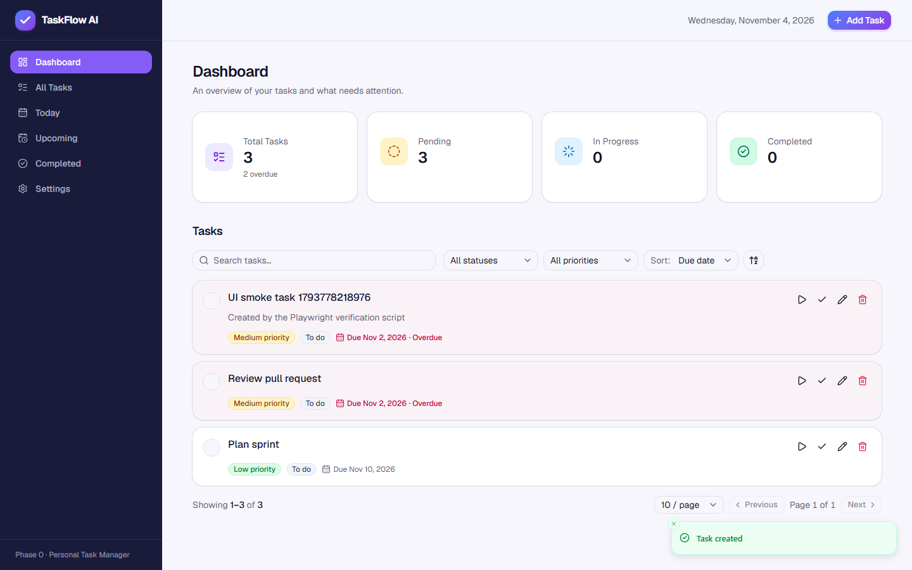
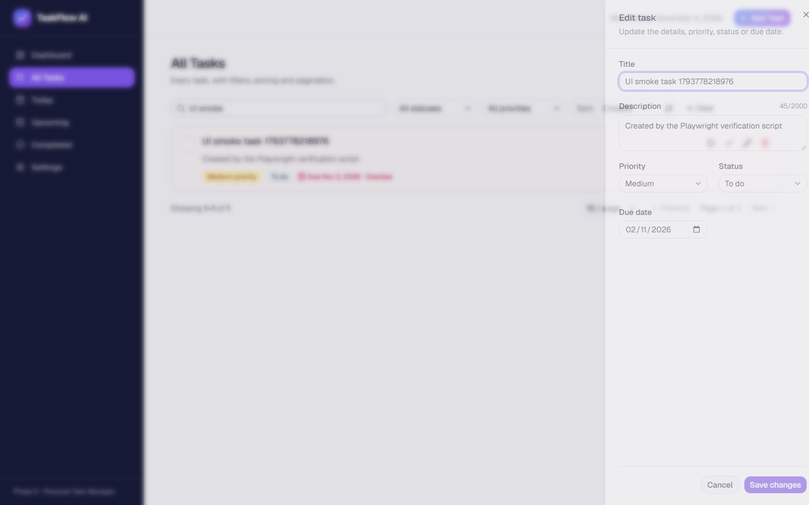
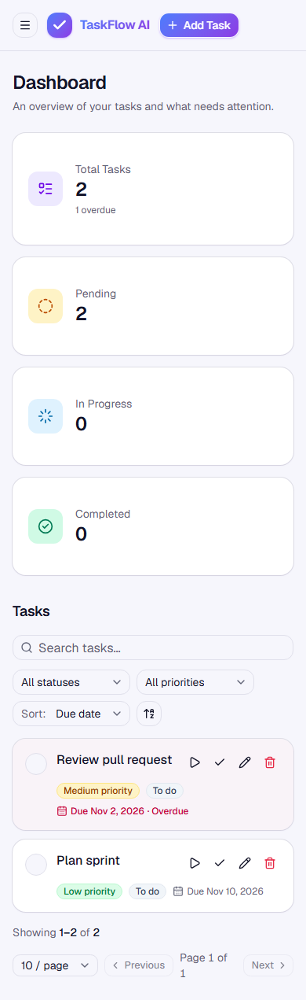

# TaskFlow AI — Phase 0

A modern, full-stack **personal task manager** built with **Spring Boot 3**, **PostgreSQL** and **Next.js**.

This repository accompanies the Medium article series
**"Building Agentic AI Applications with Java: From Spring Boot to Multi-Agent Systems Using LangChain4j"**.

| Phase | Scope | Status |
|---|---|---|
| **Phase 0** | Traditional full-stack task manager (this repository state) | ✅ Implemented |
| Phase 1 | LangChain4j + Azure OpenAI (Azure AI Foundry) + a single `TaskAgent` | Planned |
| Phase 2 | `SupervisorAgent` orchestrating `TaskAgent`, `PriorityAgent`, `PlanningAgent`, `SummaryAgent` | Planned |

> Phase 0 contains **no AI, LLM, LangChain4j, MCP or RAG code**. It builds the clean business layer that later phases will expose to agents as tools.

---

## 1. Project overview

TaskFlow AI lets a single user organise daily tasks, manage priorities, track deadlines and monitor progress through:

- a responsive **Next.js dashboard** (sidebar navigation, statistics cards, filterable/sortable/paginated task list, create/edit drawer, settings page), and
- a documented **REST API** (Swagger UI) backed by PostgreSQL.

Phase 0 is intentionally single-user: there is no authentication, and preferences are a single record.

### Screenshots

Captured from the running application (see [`docs/phase-0/screenshots`](docs/phase-0/screenshots)).

| Dashboard | Edit drawer | Mobile |
|---|---|---|
|  |  |  |

### Features

- Full task CRUD with status (`TODO`, `IN_PROGRESS`, `COMPLETED`) and priority (`LOW`, `MEDIUM`, `HIGH`)
- Complete / reopen tasks with automatic `completedAt` handling
- Database-level filtering (status, priority, due date, date range, free-text search), sorting and pagination
- Dashboard statistics: total, pending, in progress, completed, overdue, due today (timezone-aware)
- User preferences: IANA timezone and daily available minutes
- Validation on both sides (Jakarta Bean Validation + Zod), consistent `ProblemDetail` error responses
- Loading skeletons, empty states, toasts, delete confirmation, URL-synchronised filters

---

## 2. Technology stack

**Backend**

- Java 21, Spring Boot 3.5, Spring Web, Spring Data JPA, Spring Validation
- PostgreSQL 16, Flyway migrations
- Springdoc OpenAPI 2 (Swagger UI), Lombok, Maven
- JUnit 5, Mockito, Testcontainers

**Frontend**

- Next.js 16 (App Router), React 19, TypeScript
- Tailwind CSS 4, shadcn/ui (Radix), Lucide icons
- React Hook Form + Zod
- Vitest + Testing Library

**Infrastructure**

- Docker Compose for PostgreSQL (only the database runs in Docker)

---

## 3. Architecture

```text
┌────────────────────────┐        HTTP / JSON        ┌───────────────────────────────┐
│  Next.js (App Router)  │ ────────────────────────▶ │  Spring Boot (REST API)        │
│  components / hooks    │ ◀──────────────────────── │                                │
│  lib/api (fetch client)│                           │  controller  → HTTP only       │
└────────────────────────┘                           │      │                         │
                                                     │  service     → business rules  │
                                                     │      │                         │
                                                     │  repository  → Spring Data JPA │
                                                     │      │         + Specifications│
                                                     └──────┼─────────────────────────┘
                                                            ▼
                                                     ┌───────────────┐
                                                     │  PostgreSQL   │  (Flyway-managed schema)
                                                     │  tasks        │
                                                     │  user_prefs   │
                                                     └───────────────┘
```

Repository layout:

```text
taskflow-ai/
├── backend/          Spring Boot application (Maven)
├── frontend/         Next.js application
├── infrastructure/   docker-compose.yml for PostgreSQL
├── docs/phase-0/     Implementation notes for the article
└── README.md
```

Backend packages (`backend/src/main/java/com/taskflow`):

```text
controller/     TaskController, DashboardController, PreferencesController
service/        TaskService, DashboardService, PreferencesService
repository/     TaskRepository, PreferencesRepository
specification/  TaskFilter, TaskSort, TaskSpecifications  (DB-level filtering & sorting)
entity/         Task, UserPreferences
enums/          TaskStatus, TaskPriority
dto/            request/ and response/ records (API contracts)
mapper/         entity -> DTO mapping
exception/      GlobalExceptionHandler (ProblemDetail), TaskNotFoundException
validation/     @ValidTimezone
config/         ClockConfig, CorsConfig, OpenApiConfig
```

Frontend layout (`frontend/`):

```text
app/            Routes: / (dashboard), /tasks, /today, /upcoming, /completed, /settings
components/     layout/, dashboard/, tasks/, settings/, providers/, ui/ (shadcn)
hooks/          useTasks, useDashboardStats, useTaskMutations, useTaskQueryParams, useApiQuery
lib/api/        Centralised fetch client + per-resource API modules
lib/validations Zod schemas (task, preferences)
types/          TypeScript types mirroring the backend DTOs
__tests__/      Vitest + Testing Library tests
```

---

## 4. Prerequisites

| Tool | Version | Notes |
|---|---|---|
| Java (JDK) | 21 | `java -version` |
| Maven | 3.9+ | `mvn -version` |
| Node.js | 20.19+ or 22+ (tested with 24) | `node -v` |
| npm | 10+ | `npm -v` |
| Docker Desktop (or Docker Engine + Compose v2) | any recent | Only required for PostgreSQL and the backend integration tests |

---

## 5. PostgreSQL setup

Start PostgreSQL with Docker Compose:

```bash
cd infrastructure
docker compose up -d
```

This starts `postgres:16-alpine` on `localhost:5432` with database/user/password `taskflow` / `taskflow` / `taskflow`
(override via `infrastructure/.env`, see `.env.example`). Data is persisted in the `taskflow_pgdata` volume.

Useful commands:

```bash
docker compose ps                 # status
docker compose logs -f postgres   # logs
docker compose down               # stop (keeps data)
docker compose down -v            # stop and delete data
```

> **Port 5432 already in use?** If a PostgreSQL service is installed on your machine it usually owns `5432`, and the
> backend would connect to it instead of the container. Map the container to another port and point the backend at it:
>
> ```bash
> # infrastructure/.env
> POSTGRES_PORT=5433
> ```
>
> ```bash
> # when starting the backend
> DB_URL=jdbc:postgresql://localhost:5433/taskflow mvn spring-boot:run
> ```

If you prefer a locally installed PostgreSQL, create the database and user manually and point the backend at it with the
environment variables in section 8. Flyway creates the tables on first start.

---

## 6. Backend startup

```bash
cd backend
mvn spring-boot:run
```

The API starts on <http://localhost:8080>. On startup Flyway applies `V1__create_tasks.sql` and `V2__create_user_preferences.sql`,
then Hibernate validates that the entities match the schema (`ddl-auto=validate`).

To build a runnable jar:

```bash
mvn clean package -DskipTests
java -jar target/taskflow-backend-0.1.0-SNAPSHOT.jar
```

---

## 7. Frontend startup

```bash
cd frontend
npm install
npm run dev
```

Open <http://localhost:3000>. The frontend talks to the backend at `http://localhost:8080` by default
(configurable, see below).

Production build:

```bash
npm run build
npm start
```

---

## 8. Environment variables

**Backend** (`backend/src/main/resources/application.yml` reads these; all have defaults):

| Variable | Default | Description |
|---|---|---|
| `DB_URL` | `jdbc:postgresql://localhost:5432/taskflow` | JDBC URL |
| `DB_USERNAME` | `taskflow` | Database user |
| `DB_PASSWORD` | `taskflow` | Database password |
| `SERVER_PORT` | `8080` | HTTP port |
| `CORS_ALLOWED_ORIGINS` | `http://localhost:3000` | Comma-separated list of allowed origins |

**Frontend** (copy `frontend/.env.example` to `frontend/.env.local` to override):

| Variable | Default | Description |
|---|---|---|
| `NEXT_PUBLIC_API_BASE_URL` | `http://localhost:8080` | Base URL of the Spring Boot API |

**Infrastructure** (copy `infrastructure/.env.example` to `infrastructure/.env` to override):

| Variable | Default |
|---|---|
| `POSTGRES_DB` | `taskflow` |
| `POSTGRES_USER` | `taskflow` |
| `POSTGRES_PASSWORD` | `taskflow` |
| `POSTGRES_PORT` | `5432` |

---

## 9. Swagger / OpenAPI

With the backend running:

- Swagger UI: <http://localhost:8080/swagger-ui/index.html>
- OpenAPI JSON: <http://localhost:8080/v3/api-docs>

Endpoints are grouped under the **Tasks**, **Dashboard** and **Preferences** tags, with request/response schemas,
validation constraints and the documented error responses.

---

## 10. API endpoint summary

| Method | Path | Description | Success |
|---|---|---|---|
| `POST` | `/api/tasks` | Create a task (status `TODO`, priority defaults to `MEDIUM`) | `201` |
| `GET` | `/api/tasks` | List tasks with filtering, sorting and pagination | `200` |
| `GET` | `/api/tasks/{id}` | Get one task | `200` |
| `PUT` | `/api/tasks/{id}` | Replace title, description, priority, status, due date | `200` |
| `PATCH` | `/api/tasks/{id}/status` | Change status (complete / reopen) | `200` |
| `DELETE` | `/api/tasks/{id}` | Delete a task | `204` |
| `GET` | `/api/dashboard/stats` | Counts: total, pending, inProgress, completed, overdue, dueToday | `200` |
| `GET` | `/api/preferences` | Read preferences | `200` |
| `PUT` | `/api/preferences` | Update timezone and daily available minutes | `200` |

List query parameters for `GET /api/tasks`:

| Parameter | Example | Notes |
|---|---|---|
| `status` | `TODO` or `TODO,IN_PROGRESS` | One or more statuses |
| `priority` | `HIGH` | |
| `dueDate` | `2026-11-02` | Exact date |
| `dueDateFrom` / `dueDateTo` | `2026-11-03` | Inclusive range |
| `search` | `article` | Case-insensitive match on title or description |
| `sortBy` | `DUE_DATE`, `PRIORITY`, `CREATED_AT` (default), `UPDATED_AT` | Priority sorts by rank, not alphabetically |
| `sortDirection` | `ASC`, `DESC` (default) | |
| `page` / `size` | `0` / `10` | Zero-based page; size 1–100 |

Example:

```http
GET /api/tasks?status=TODO&priority=HIGH&sortBy=DUE_DATE&sortDirection=ASC&page=0&size=10
```

Errors use RFC 9457 Problem Details (`application/problem+json`):

```json
{
  "type": "about:blank",
  "title": "Validation error",
  "status": 400,
  "detail": "Validation failed",
  "instance": "/api/tasks",
  "errors": { "title": "Title must not be blank" }
}
```

| Situation | Status |
|---|---|
| Validation error / invalid enum value / malformed body | `400` |
| Unknown task id | `404` |
| Unexpected error | `500` |

---

## 11. Testing

**Backend** (unit tests with JUnit 5 + Mockito, integration tests with Testcontainers — Docker must be running):

```bash
cd backend
mvn clean verify
```

Covers: task creation defaults, completion/reopen timestamps, updates, unknown ids, dashboard statistics (unit);
Flyway migrations, repository filtering/sorting/pagination, REST endpoints, validation errors, persistence (integration).

**Frontend** (Vitest + Testing Library):

```bash
cd frontend
npm test          # run once
npm run test:watch
npm run lint
npm run typecheck
```

Covers: task form validation, task list rendering (badges, overdue highlight, empty/loading/error states),
task creation through the drawer, complete/reopen status updates, date helpers.

---

## 12. Roadmap

- **Phase 1 — Single agent.** Add LangChain4j and Azure OpenAI (via Azure AI Foundry). A `TaskAgent` exposes the existing
  `TaskService` operations as tools, so natural-language requests ("add a high-priority task for tomorrow") map onto the same
  business logic used by the REST API. A chat interface is added to the Next.js UI.
- **Phase 2 — Multi-agent orchestration.** A `SupervisorAgent` routes requests to specialised agents (`TaskAgent`,
  `PriorityAgent`, `PlanningAgent`, `SummaryAgent`), using the timezone and daily available minutes preferences for planning.

See [`docs/phase-0/IMPLEMENTATION.md`](docs/phase-0/IMPLEMENTATION.md) for the design decisions behind Phase 0.
